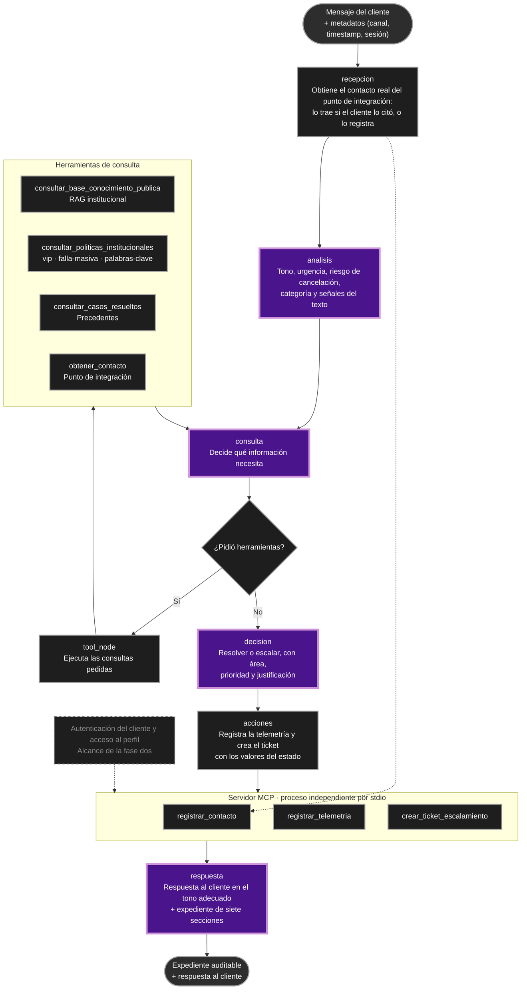

# Diagrama del Agente Propuesto - Telco Andina

Con base en el caso y las convenciones visuales proporcionadas, a continuación se presenta el diagrama de flujo para el agente de atención al cliente.

> En este diagrama se han aplicado las siguientes convenciones:
> - **Óvalos**: Entrada del cliente o fin de la conversación.
> - **Rectángulos**: Nodos técnicos (acciones deterministas, integraciones con sistemas).
> - **Rectángulos con borde más grueso y color distinto (morado)**: Nodos LLM donde el modelo razona, interpreta y redacta.
> - **Rombos**: Decisiones agénticas tomadas por el juicio del LLM, no por reglas fijas.

```mermaid
flowchart TD
    %% Definición de clases según las convenciones solicitadas (Modo Dark)
    classDef ovalo fill:#2d2d2d,stroke:#a0a0a0,stroke-width:2px,color:#ffffff,rx:20,ry:20;
    classDef rectangulo fill:#1e1e1e,stroke:#a0a0a0,stroke-width:2px,color:#ffffff;
    classDef nodoLLM fill:#4a148c,stroke:#ce93d8,stroke-width:4px,color:#ffffff;
    classDef rombo fill:#1e1e1e,stroke:#a0a0a0,stroke-width:2px,color:#ffffff;

    %% Leyenda
    subgraph Leyenda [Convenciones Visuales]
        L1(["Inicio / Fin<br>Entrada del cliente"])
        L2["Nodo Técnico<br>Acción determinista"]
        L3["Nodo LLM<br>El modelo razona"]
        L4{"Decisión Agéntica<br>Juicio del LLM"}
    end

    %% Flujo Principal
    INICIO(["Entrada del cliente:<br>Mensaje + Metadatos"])
    RECEPCION["Obtener contenido vía<br>punto de integración interno"]
    
    ANALISIS_INICIAL["Analizar mensaje:<br>Identificar tono, urgencia, riesgo churn<br>y clasificar tipo de problema"]
    
    DECISION_AUTH{"¿Requiere acceder a<br>datos privados de la cuenta?"}
    
    INFO_PUBLICA["Búsqueda semántica (RAG) en<br>Base de Conocimiento Institucional"]
    
    SOLICITAR_AUTH["Redactar solicitud de<br>autenticación al cliente"]
    INGRESO_CREDENCIALES(["Cliente ingresa<br>cédula y clave"])
    INFO_PRIVADA["Consultar Sistema de Información<br>del Cliente (Perfil, tickets, etc.)"]
    
    CONSULTA_HISTORICO["Consultar Base de<br>Conocimiento Histórico"]
    
    ANALISIS_ESTRATEGICO["Ponderar problemas, evaluar<br>políticas y definir abordaje"]
    
    DECISION_ESCALAMIENTO{"¿Es posible resolver<br>en primera línea?"}
    
    REDACTAR_RESOLUCION["Generar expediente y redactar<br>respuesta final con compromisos"]
    REDACTAR_ESCALAMIENTO["Generar expediente, redactar respuesta<br>y determinar área destino/prioridad"]
    
    REGISTRO["Registrar interacción en<br>Sistema de Telemetría"]
    
    EMITIR["Emitir respuesta al cliente y/o<br>transferir ticket a área humana"]
    
    FIN(["Fin de la interacción"])

    %% Conexiones
    INICIO --> RECEPCION
    RECEPCION --> ANALISIS_INICIAL
    ANALISIS_INICIAL --> DECISION_AUTH
    
    DECISION_AUTH -- "No (Información Pública)" --> INFO_PUBLICA
    DECISION_AUTH -- "Sí (Datos de Cuenta)" --> SOLICITAR_AUTH
    
    SOLICITAR_AUTH --> INGRESO_CREDENCIALES
    INGRESO_CREDENCIALES --> INFO_PRIVADA
    
    INFO_PUBLICA --> CONSULTA_HISTORICO
    INFO_PRIVADA --> CONSULTA_HISTORICO
    
    CONSULTA_HISTORICO --> ANALISIS_ESTRATEGICO
    ANALISIS_ESTRATEGICO --> DECISION_ESCALAMIENTO
    
    DECISION_ESCALAMIENTO -- "Sí (Resolver)" --> REDACTAR_RESOLUCION
    DECISION_ESCALAMIENTO -- "No (Escalar)" --> REDACTAR_ESCALAMIENTO
    
    REDACTAR_RESOLUCION --> REGISTRO
    REDACTAR_ESCALAMIENTO --> REGISTRO
    
    REGISTRO --> EMITIR
    EMITIR --> FIN

    %% Asignación de clases segura para evitar errores de parseo
    class L1,INICIO,INGRESO_CREDENCIALES,FIN ovalo;
    class L2,RECEPCION,INFO_PUBLICA,INFO_PRIVADA,CONSULTA_HISTORICO,REGISTRO,EMITIR rectangulo;
    class L3,ANALISIS_INICIAL,SOLICITAR_AUTH,ANALISIS_ESTRATEGICO,REDACTAR_RESOLUCION,REDACTAR_ESCALAMIENTO nodoLLM;
    class L4,DECISION_AUTH,DECISION_ESCALAMIENTO rombo;
```

---

# Diagrama actualizado — semana 2

El diagrama de arriba se conserva como el propuesto en la semana 1. Este es el
que corresponde a la implementación con tool calling e integración MCP.

Las convenciones son las mismas, y se mantiene la distinción que ya traía el
diagrama original: las cajas técnicas son pasos deterministas del código, las
moradas son pasos donde razona el modelo y los rombos son decisiones agénticas.

Diferencias con el diagrama de la semana 1:

- El flujo dejó de ser una secuencia única. El tramo `consulta ⇄ tool_node` es un
  ciclo, y el modelo decide en cada vuelta qué consulta.
- El registro de auditoría y la creación del ticket quedaron dentro de un paso
  determinista (`acciones`), que corre siempre entre la decisión y la respuesta.
- Las herramientas quedaron separadas por su efecto: las de lectura corren en el
  proceso del agente y las tres que escriben viven en el servidor MCP.
- La red de seguridad del ciclo vive en el estado (`iteracion`, `max_iteraciones`).
- La rama de autenticación queda marcada como alcance de la fase dos.
