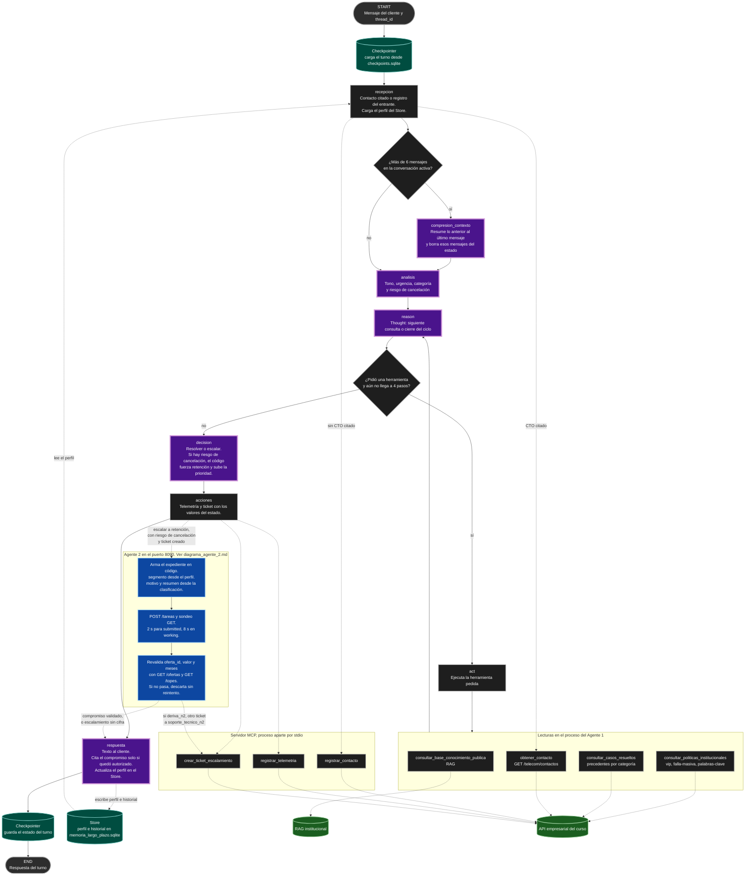

# Diagrama del Agente 1 final

Grafo compilado en `agent/graph.py`. El ciclo `reason` / `act` sale de `agent/reasoning/react.py`. La llamada al Asesor de Retención sale de `acciones` por `agent/a2a_cliente.py` y no es un nodo del grafo.

El detalle del Agente 2 está en `diagrama_agente_2.md`. Aquí ese proceso es una caja: el Agente 1 le manda el expediente y solo cita el `compromiso` si el código lo revalida.

## Qué hace cada tramo

- `recepcion` consigue el contacto. Si el mensaje cita un `CTO-xxx`, llama a `obtener_contacto`. Si no, registra el entrante con `registrar_contacto`. Si hay cédula, `cliente_existe` solo dice si la persona existe. El perfil del Store entra en este nodo.
- `compresion_contexto` resume los mensajes anteriores al último del cliente cuando la conversación activa pasa de 6 mensajes.
- `analisis` clasifica tono, urgencia, categoría y `riesgo_churn`.
- `reason` y `act` son el ciclo ReAct. Thought en `reason`, Action en `act`, Observation de vuelta a `reason`. El tope es 4 pasos (`max_iterations`). Al llegar, el modelo ya no puede llamar herramientas.
- `decision` propone resolver o escalar. Si hay `riesgo_churn`, el código fuerza `escalar`, área `retencion` y prioridad al menos `alta`.
- `acciones` escribe telemetría y, si escala, el ticket. Los dos salen del estado, no del texto que el modelo acaba de redactar. Solo si la decisión es escalar a retención, hay riesgo de cancelación y el ticket existe, arma el expediente y llama al Agente 2.
- `respuesta` redacta lo que oye el cliente y actualiza el perfil en el Store. Si el artefacto no pasó la revalidación, informa el escalamiento y no nombra cifras.

## Fuentes

| Fuente | Quién la toca | Qué saca |
| ----- | ----- | ----- |
| RAG institucional | `consultar_base_conocimiento_publica`, desde `act` | Planes, tarifas, tiendas, horarios, políticas públicas |
| API empresarial | `consultar_politicas_institucionales`, `consultar_casos_resueltos`, `obtener_contacto` | Políticas, precedentes y el contacto citado |
| API empresarial, vía MCP | `registrar_contacto`, `registrar_telemetria`, `crear_ticket_escalamiento` | Escrituras de auditoría y tickets |
| Checkpointer (`data/checkpoints.sqlite`) | El grafo, por `thread_id` | El turno en curso |
| Store (`data/memoria_largo_plazo.sqlite`) | `recepcion` lee, `respuesta` escribe | Perfil del cliente entre conversaciones |
| Agente 2, HTTP en el puerto 8090 | `acciones`, cliente A2A | `compromiso` ya filtrado. La revalidación lee `GET /ofertas/{id}` y `GET /topes/{segmento}` |

El `segmento` del expediente sale del perfil o de una herramienta que marcó VIP. El chat no lo mueve. `motivo` y `resumen` salen de la clasificación, no del mensaje crudo.

## Convenciones

- Óvalos: entrada del cliente y fin del turno.
- Rectángulos: nodos de código (`recepcion`, `act`, `acciones`).
- Rectángulos de borde grueso morado: nodos donde habla el modelo.
- Rombos: aristas del grafo.
- Cilindros verde azulado: memoria del Agente 1 (Checkpointer y Store).
- Cilindros verdes: fuentes de datos (RAG y API empresarial).
- Caja azul: el Agente 2, otro proceso. El trazo punteado es una llamada, no una arista de LangGraph.

