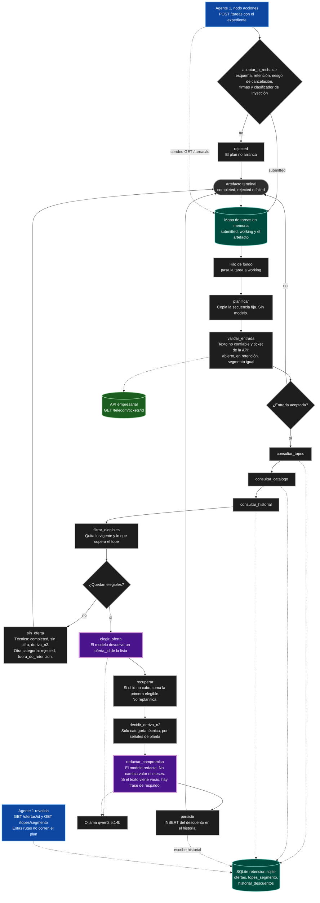

# Diagrama del Agente 2: Asesor de Retención

Proceso HTTP propio (`agente2/app.py`, puerto 8090). No habla con el cliente. El Agente 1 lo llama desde `acciones` cuando el caso escala a retención. El grafo del plan está en `agente2/razonamiento/plan_execute.py`.

El Agente 1, con su ciclo ReAct y sus fuentes, está en `diagrama_agente_1.md`.

## Qué decide el código y qué elige el modelo

El patrón es Plan-and-Execute. El plan no lo escribe el modelo: `planificar` copia la secuencia fija y el grafo la recorre. No hay vuelta a `planificar`.

El modelo solo entra en dos nodos. `elegir_oferta` devuelve un `oferta_id` de la lista ya filtrada. `redactar_compromiso` escribe el texto y la justificación sin cambiar valor ni meses. Si el id no está en la lista, `recuperar` toma la primera elegible. Si el texto viene vacío, el código pone una frase de respaldo con las cifras ya autorizadas.

## Puerta HTTP, antes del grafo

`POST /tareas` pasa por `aceptar_o_rechazar`. Si el cuerpo no cumple el esquema, no hay `riesgo_churn`, el área no es `retencion`, o `motivo` y `resumen` disparan el detector de firmas o el clasificador de inyección, la tarea queda `rejected` y el plan no arranca.

Si queda `submitted`, un hilo marca `working` y corre el grafo. El Agente 1 sondea `GET /tareas/{tarea_id}` hasta un estado terminal. Esas tareas viven en un diccionario del proceso. Un reinicio las borra. Catálogo, topes e historial no: están en SQLite.

`GET /ofertas/{oferta_id}` y `GET /topes/{segmento}` no ejecutan el plan. Sirven para que el Agente 1 revalide el artefacto contra la misma base.

## El plan

1. `validar_entrada` repite el control de texto. Luego lee `GET /telecom/tickets/{ticket_id}` en la API del curso. El ticket tiene que existir, seguir abierto y estar en retención, y el segmento tiene que coincidir. Si no, `rejected` (`entrada_no_confiable`, `ticket_desconocido`, `fuera_de_retencion` o `segmento_no_coincide`) y se acaba el recorrido.
2. `consultar_topes`, `consultar_catalogo` y `consultar_historial` leen las tres tablas.
3. `filtrar_elegibles` deja fuera lo ya otorgado y lo que se pasa del tope. Si no queda ninguna, `sin_oferta`: con categoría técnica cierra `completed`, sin cifra y con `deriva_n2`; en otro caso, `rejected` con `fuera_de_retencion`.
4. Con elegibles, el modelo elige, el código recupera, `decidir_deriva_n2` mira señales de planta solo si la categoría es técnica, el modelo redacta y `persistir` hace el `INSERT` del historial.

## Fuentes

| Fuente | Quién la toca | Qué saca |
| ----- | ----- | ----- |
| `ofertas` | `consultar_catalogo`, y el GET de revalidación | Catálogo activo por segmento y categoría |
| `topes_segmento` | `consultar_topes`, el filtro y el GET de revalidación | Valor y meses máximos |
| `historial_descuentos` | `consultar_historial` lee, `persistir` escribe | Beneficios vigentes de esa cuenta |
| API empresarial | Solo `validar_entrada` | `GET /telecom/tickets/{ticket_id}` |
| Ollama (`qwen2.5:14b`) | `elegir_oferta` y `redactar_compromiso` | Un id de la lista, y el texto del compromiso |

Las tres tablas las sembró el equipo en `retencion.sqlite`. No salen de la API del curso.

## Convenciones

- Óvalo: fin del recorrido, con o sin oferta.
- Rectángulos: código. El borde grueso morado es un nodo con modelo.
- Rombos: salidas del grafo (entrada rechazada, o lista vacía).
- Cilindro verde azulado: SQLite del especialista y el mapa de tareas en memoria.
- Cilindro verde: la API empresarial, la única lectura fuera de esa SQLite.
- Caja azul: el Agente 1. Envía la tarea y, al recibir el artefacto, revalida por otras rutas HTTP. Esas rutas no son nodos del plan.
- Trazo punteado: lectura o escritura fuera del orden del grafo.

