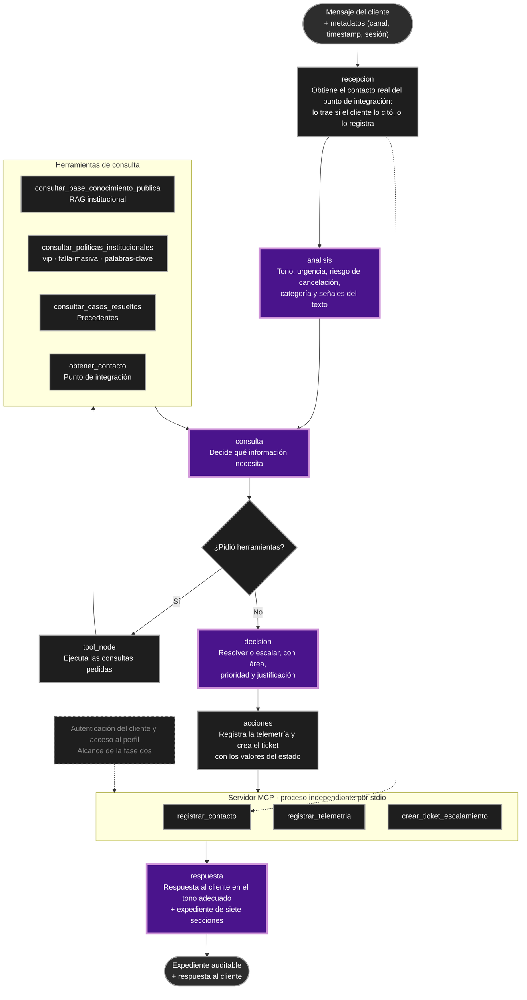

# Diagrama del Agente Propuesto — Semana 2 (Tool Calling y MCP)

Este diagrama corresponde a la implementación del agente con tool calling e integración de herramientas locales y del servidor MCP.

Las convenciones son las mismas: las cajas técnicas son pasos deterministas del código, las moradas son pasos donde razona el modelo y los rombos son decisiones agénticas.

Diferencias con el diagrama de la semana 1:

- El flujo dejó de ser una secuencia única. El tramo `consulta ⇄ tool_node` es un ciclo, y el modelo decide en cada vuelta qué consulta.
- El registro de auditoría y la creación del ticket quedaron dentro de un paso determinista (`acciones`), que corre siempre entre la decisión y la respuesta.
- Las herramientas quedaron separadas por su efecto: las de lectura corren en el proceso del agente y las tres que escriben viven en el servidor MCP.
- La red de seguridad del ciclo vive en el estado (`iteracion`, `max_iteraciones`).
- La rama de autenticación queda marcada como alcance de la fase dos.
