# Diagrama de Arquitectura del Agente — Semana 4 (Memoria y Compresión)

Este diagrama representa la arquitectura y el flujo de ejecución de LangGraph implementado en `agent/graph.py`, extendido con las capacidades de persistencia de **Memoria de Corto Plazo (Checkpointer)**, **Memoria de Largo Plazo (Store)** y **Compresión de Contexto**.

## Justificación de Negocio (Caso Telco Andina)

- **Memoria de Corto Plazo (`Checkpointer`):** Mantiene el estado (`AgentState`) y los mensajes de la interacción activa indexados por `thread_id`. Permite recordar el contacto citado (`CTO-001`), la categoría del problema y las acciones de descarte ya realizadas (ej. reinicio de módem) a lo largo de múltiples turnos.
- **Memoria de Largo Plazo (`Store`):** Persiste información histórica del cliente (`cliente_id`) entre distintas sesiones independientes. Permite que el agente reconozca el estatus VIP, la recurrencia de fallas en el mes y acuerdos previos desde el saludo inicial.
- **Compresión de Contexto (`compresion_contexto`):** Cuando una conversación multi-turno supera un umbral razonable de mensajes, se activa una arista condicional para resumir el historial antiguo, protegiendo la ventana de contexto del LLM y manteniendo la coherencia de razonamiento.

## Convenciones Visuales
- **Óvalos**: Entrada del cliente (`START`) o fin de la interacción (`END`).
- **Rectángulos**: Nodos deterministas técnicos (`recepcion`, `tool_node`, `acciones`).
- **Rectángulos con borde grueso morado**: Nodos de razonamiento LLM (`analisis`, `consulta`, `decision`, `respuesta`, `compresion_contexto`).
- **Rombos**: Aristas condicionales de enrutamiento agéntico (`¿Mensajes > Umbral?`, `hay_consultas_pendientes`).
- **Cilindros / Verde azulado**: Capas de persistencia de memoria (`Checkpointer`, `Store`).
- **Subgrafos**: Herramientas locales de lectura (in-process) y herramientas de mutación/auditoría (servidor MCP).

```mermaid
flowchart TD
    classDef ovalo fill:#2d2d2d,stroke:#a0a0a0,stroke-width:2px,color:#ffffff;
    classDef rectangulo fill:#1e1e1e,stroke:#a0a0a0,stroke-width:2px,color:#ffffff;
    classDef nodoLLM fill:#4a148c,stroke:#ce93d8,stroke-width:4px,color:#ffffff;
    classDef rombo fill:#1e1e1e,stroke:#a0a0a0,stroke-width:2px,color:#ffffff;
    classDef memoria fill:#004d40,stroke:#80cbc4,stroke-width:2px,color:#ffffff;

    %% Puntos de Entrada y Memoria
    START(["START / Mensaje del Cliente<br>+ thread_id en config"])
    CHECKPOINTER[("Checkpointer (SqliteSaver)<br>Recupera/Guarda estado por thread_id")]
    STORE[("Store (Memoria Largo Plazo)<br>Perfiles de clientes e historial transversal")]

    %% Nodo 1: Recepción
    RECEPCION["recepcion (Determinista)<br>Obtiene contacto citado (CTO-xxx) o registra entrante<br>Carga perfil histórico del cliente desde el Store"]

    %% Nodo Compresión / Condicional
    DEC_COMPRESION{"¿Mensajes > Umbral?<br>Evalúa longitud del historial"}
    COMPRESION["compresion_contexto (LLM)<br>Resume mensajes antiguos preservando hechos clave<br>para proteger la ventana de contexto"]

    %% Nodo 2: Análisis
    ANALISIS["analisis (LLM ChatOllama)<br>Clasifica tono, urgencia, categoría y riesgo de churn"]

    %% Nodo 3: Consulta y Ciclo de Herramientas
    CONSULTA["consulta (LLM ChatOllama con Tools)<br>Decide qué herramientas de consulta necesita invocar"]
    DEC_TOOLS{"hay_consultas_pendientes<br>¿El modelo generó tool_calls?"}
    TOOLS["tool_node (ToolNode)<br>Ejecuta consultas de lectura"]

    subgraph HERRAMIENTAS_LOCALES ["Herramientas de Lectura (In-Process / API Empresarial y RAG)"]
        T1["consultar_base_conocimiento_publica"]
        T2["consultar_politicas_institucionales"]
        T3["consultar_casos_resueltos"]
        T4["obtener_contacto"]
    end

    %% Nodo 4: Decisión
    DECISION["decision (LLM ChatOllama)<br>Determina resolver o escalar<br>Aplica correcciones defensivas de políticas"]

    %% Nodo 5: Acciones (MCP)
    ACCIONES["acciones (Determinista / MCP Client)<br>Ejecuta mutaciones de auditoría en el sistema"]

    subgraph SERVIDOR_MCP ["Servidor MCP (Subproceso independiente vía stdio)"]
        T5["registrar_contacto"]
        T6["registrar_telemetria"]
        T7["crear_ticket_escalamiento"]
    end

    %% Nodo 6: Respuesta y Persistencia Final
    RESPUESTA["respuesta (LLM ChatOllama)<br>Genera respuesta empática al cliente<br>y compila expediente de 7 secciones<br>Actualiza perfil e historial en el Store"]

    END_NODE(["END / Respuesta y Expediente<br>Persiste checkpoint final"])

    %% Conexiones del Flujo
    START --> CHECKPOINTER
    CHECKPOINTER --> RECEPCION

    STORE -.-> |"1. Lectura de perfil"| RECEPCION

    RECEPCION --> DEC_COMPRESION
    DEC_COMPRESION -- "Sí (Supera límite)" --> COMPRESION
    COMPRESION --> ANALISIS
    DEC_COMPRESION -- "No" --> ANALISIS

    ANALISIS --> CONSULTA
    CONSULTA --> DEC_TOOLS
    DEC_TOOLS -- "Sí (tool_calls)" --> TOOLS
    DEC_TOOLS -- "No (texto final)" --> DECISION

    TOOLS --> HERRAMIENTAS_LOCALES
    HERRAMIENTAS_LOCALES --> CONSULTA

    DECISION --> ACCIONES
    ACCIONES --> SERVIDOR_MCP
    SERVIDOR_MCP --> RESPUESTA

    RESPUESTA -.-> |"2. Actualización de perfil"| STORE
    RESPUESTA --> CHECKPOINTER
    CHECKPOINTER --> END_NODE

    %% Asignación de Clases
    class START,END_NODE ovalo;
    class RECEPCION,TOOLS,ACCIONES,T1,T2,T3,T4,T5,T6,T7 rectangulo;
    class ANALISIS,CONSULTA,DECISION,RESPUESTA,COMPRESION nodoLLM;
    class DEC_COMPRESION,DEC_TOOLS rombo;
    class CHECKPOINTER,STORE memoria;
```

