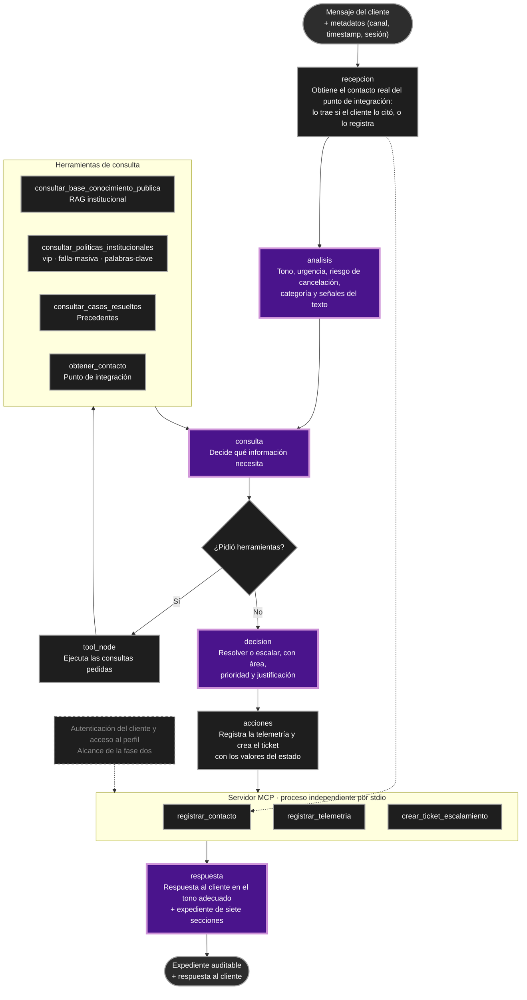
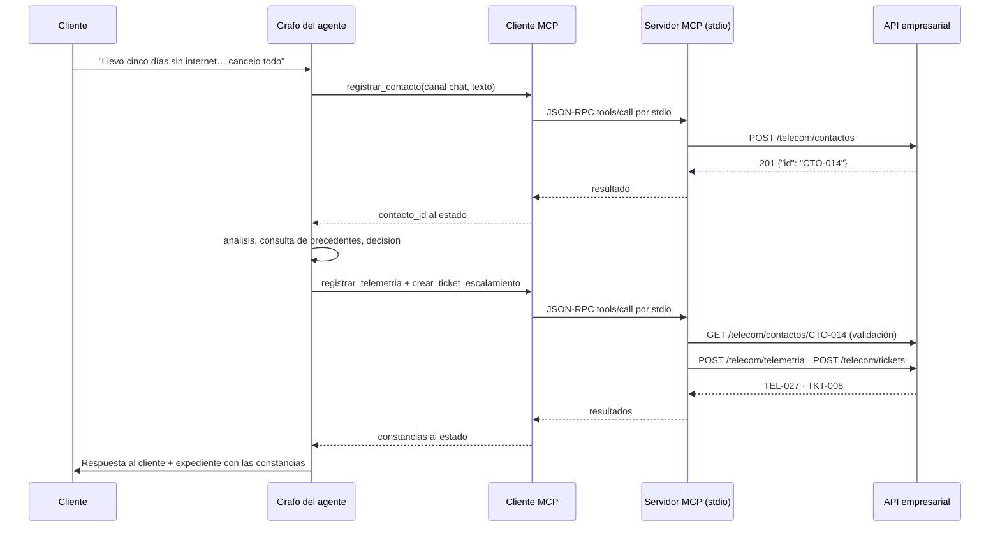

# Borrador para la wiki: semana 2

Secciones 1, 3 y 4. La sección 2 ya está publicada y se conserva como está.

---

## 1. Reflexión y diagrama actualizado

### Hipótesis del diagrama de la semana 1 que resultaron incompletas

**El flujo es una secuencia fija de una sola pasada.** El diagrama original encadenaba análisis, consulta, decisión, registro y emisión en un orden dibujado de antemano. Con tool calling, el tramo de consulta es un ciclo: el modelo decide en cada vuelta qué necesita, cuántas herramientas invoca y en qué orden. El grafo enruta, y la secuencia la define el caso concreto.

**Las cajas del dibujo son todas nodos del grafo.** En la implementación, las que representan una consulta son herramientas, y esa diferencia cambia quién decide. Un nodo obliga a pasar por él; una herramienta la invoca el modelo cuando la considera necesaria. Esa es justamente la capacidad que la entrega de esta semana pide demostrar.

**Poner el nodo de registro antes del de emisión garantiza el orden regulatorio.** La posición en el dibujo expresa una intención, y la garantía real vive en el código. Mientras el registro dependió de una instrucción en el prompt, el agente llegó a registrar telemetría con un identificador inventado (`CTO-1234567890`), con categoría "consulta" y decisión "resolver", mientras su propia respuesta decía "escalar". La solución fue convertir el registro en un paso determinista que escribe con los valores del estado: la auditoría y la respuesta leen la misma fuente, así que ya no pueden contradecirse.

**En el canal de chat siempre hay un contacto.** El diagrama daba por hecho que el mensaje llega desde el punto de integración con su identificador. En el chat en vivo no llega, y el agente lo inventaba para poder registrar. El nodo de recepción lo resuelve: si el cliente cita un `CTO-xxx`, lo trae; si no, registra el contacto entrante y se queda con el identificador que devuelve la API.

**Un flujo acíclico se termina solo.** Al introducir el ciclo aparece la posibilidad de que el modelo siga pidiendo herramientas sin converger. Medido con `qwen2.5:3b`: repitió las mismas llamadas hasta agotar el `recursion_limit` de LangGraph. El diseño incorporó la red de seguridad del laboratorio 5, con el contador en el estado.

**Todas las fuentes se consultan de la misma forma.** La implementación separa las herramientas por su efecto: las de consulta corren en el proceso del agente y las tres que modifican el negocio viven en el servidor MCP. Esa frontera es nueva respecto al diagrama original y es la que hace verificable el registro de auditoría.

**La autenticación del cliente pertenece al flujo principal.** El caso ubica el acceso al perfil en la fase dos. El diagrama actualizado deja esa rama marcada como tal y concentra la primera fase en información pública, precedentes y acciones.

### Diagrama actualizado



### Qué cambió en el diseño y por qué

El grafo pasó de siete cajas dibujadas en línea a siete nodos con una topología distinta, y cada nodo hace una sola cosa:

```
NODOS: recepcion, analisis, consulta, tool_node, decision, acciones, respuesta
  __start__ -> recepcion -> analisis -> consulta
  consulta  -> tool_node (condicional)   tool_node -> consulta
  consulta  -> decision  (condicional)
  decision  -> acciones  -> respuesta -> __end__
```

El reparto sigue la convención del propio diagrama de la semana 1. Los pasos deterministas son `recepcion`, `tool_node` y `acciones`. Los pasos de razonamiento son `analisis`, `consulta`, `decision` y `respuesta`. La única decisión enrutada es si el modelo pidió herramientas.

Dar una sola tarea por nodo tuvo un efecto medible con `qwen2.5:3b`. Cuando un único nodo veía las seis herramientas y debía clasificar, consultar, decidir, registrar y redactar a la vez, el modelo repetía llamadas, emitía las llamadas como texto plano y no cerraba el caso. Con la tarea partida, los tres escenarios de prueba se completan.

El estado dejó de ser solo la lista de mensajes. Usa el reductor `add_messages` del laboratorio 8, que identifica los mensajes por id, y suma los campos del caso: identificadores del contacto y del cliente, clasificación, decisión y el contador de la red de seguridad.

---

## 3. Agente con tool calling

### Estado del agente

```python
class AgentState(TypedDict, total=False):
    messages: Annotated[list[AnyMessage], add_messages]

    contacto_id: str          # escritos por `recepcion`
    cliente_id: str | None
    texto_contacto: str

    tono: str                 # escritos por `analisis`
    urgencia: str
    riesgo_churn: bool
    categoria: str
    categoria_secundaria: str | None

    decision: str             # escritos por `decision`
    area_destino: str | None
    prioridad: str
    justificacion: str

    iteracion: int            # red de seguridad del ciclo
    max_iteraciones: int
```

Que estos campos vivan en el estado es lo que hace coherente el expediente: `acciones` registra la telemetría con estos valores y `respuesta` redacta a partir de los mismos.

### Flujo 1: consulta pública resuelta en primera línea

Situación A del caso. El agente decide consultar la base de conocimiento, usa el resultado y cierra el caso.

```
tú ❯ ¿A qué hora cierra la tienda de Chapinero?

[análisis] tono=neutro · urgencia=baja · riesgo de cancelación=no · categoría=consulta

  🔧 consultar_base_conocimiento_publica({"query": "horario de la tienda de Chapinero"})
     ↳ {"estado": "ok", "respuesta": "El horario de la tienda Chapinero (Bogotá) es
        8am – 6pm (L–V), sábado 9am – 2pm, domingos no atiende. [1]",
        "fuentes": ["doc_teleco_andina_servicios"]}

[auditoría] telemetría TEL-025

agente: (respuesta al cliente con el horario, seguida del expediente de siete secciones)
```

Registro que quedó en la API:

```json
{"contacto_id": "CTO-012", "categoria": "consulta", "tono_detectado": "neutro",
 "urgencia": "baja", "riesgo_churn": false, "decision": "resolver",
 "detalle": "El horario de la tienda de Chapinero ya ha sido proporcionado en el
             conocimiento público con detalle.",
 "id": "TEL-025", "registrado_en": "2026-08-15T20:31:36+00:00"}
```

El contacto `CTO-012` lo creó el nodo de recepción: en el chat el cliente no trae identificador, y la auditoría lo exige.

### Flujo 2: escalamiento con acción sobre el negocio

Situación B del caso.

```
tú ❯ Llevo cinco días sin internet, ya llamé tres veces, si no me resuelven hoy
     cancelo todo y me llevo las tres líneas a la competencia.

[análisis] tono=urgente · urgencia=alta · riesgo de cancelación=sí · categoría=tecnica

  🔧 consultar_casos_resueltos({"categoria": "tecnica"})
     ↳ {"estado": "ok", "casos": [{"id": "CAS-001", "sintoma": "Sin servicio total por
        más de 24 horas", "solucion": "Verificar falla masiva en la zona; si no aplica,
        agendar visita técnica prioritaria en menos de 24h y aplicar descuento
        proporcional por días sin servicio."}]}

[auditoría] telemetría TEL-027 · ticket TKT-008 a retencion
```

Ticket creado:

```json
{"contacto_id": "CTO-014", "categoria": "tecnica", "prioridad": "alta",
 "area_destino": "retencion",
 "resumen": "Llevo cinco días sin internet… | El cliente ha expresado su intención de
             cancelar si no se resuelve hoy, lo que aumenta el riesgo de pérdida de
             clientes.[corrección: riesgo de cancelación: no se cierra en primera línea;
             riesgo de cancelación: retención por política institucional]",
 "id": "TKT-008", "estado": "abierto"}
```

El destino es retención con prioridad alta, que es lo que el caso prescribe para la Situación B. Lo garantiza el bloque de corrección del nodo `decision`, tomado del laboratorio 5: cuando la decisión del modelo contradice lo que el estado ya sabe, gana el estado. Aquí el modelo había propuesto soporte técnico N1, y la política institucional asigna retención de forma directa ante cualquier intención de cancelar. La corrección queda escrita en el propio ticket, así que la auditoría puede verla.

### Flujo 3: caso VIP con consulta de política

```
tú ❯ Soy cliente VIP hace 7 años y llevo cinco días sin internet. Si no me
     resuelven hoy, cancelo. Mi contacto es CTO-001.

[análisis] tono=urgente · urgencia=alta · riesgo de cancelación=sí · categoría=tecnica

  🔧 obtener_contacto({"contacto_id": "CTO-001"})
     ↳ {"estado": "ok", "contacto": {"id": "CTO-001", "cliente_id": "CLI-1001", …}}
  🔧 consultar_politicas_institucionales({"tipo": "vip"})
     ↳ {"estado": "ok", "politica": {"nombre": "Escalamiento mínimo garantizado VIP",
        "regla": "Escalamiento mínimo garantizado a N2 o superior… Agente de retención
        asignado de forma directa ante cualquier intención de cancelación…",
        "sla_critica_minutos": 30}}

[auditoría] telemetría TEL-031 · ticket TKT-012 a retencion
```

Aquí el agente cita el contacto, así que el nodo de recepción lo trae del punto de integración en vez de crear uno nuevo, y de ahí sale el `cliente_id` que viaja al ticket.

### Manejo de errores

Toda herramienta devuelve un JSON con una de dos formas:

```json
{"estado": "ok",    "...": "datos"}
{"estado": "error", "codigo": "...", "mensaje": "...", "accion_sugerida": "..."}
```

`accion_sugerida` es la pieza deliberada: ante una falla el modelo recibe una instrucción de qué hacer, no un mensaje técnico.

**El servicio de conocimiento no responde.** El cliente de RAG tipifica los modos de falla con códigos estables (`rate_limit`, `credenciales_invalidas`, `sin_conexion`, `pregunta_rechazada`, `coleccion_no_existe`, `respuesta_invalida`). Un `401` renueva el token y reintenta una vez. Un `429` lee el header `Retry-After`: si la espera es de 15 segundos o menos, espera y reintenta; si es mayor, devuelve el error para que el agente decida sin bloquear el turno.

Corrida con el RAG apuntando a un puerto muerto:

```
  🔧 consultar_base_conocimiento_publica({"query": "horario de la tienda de Chapinero"})
     ↳ {"estado": "error", "codigo": "sin_conexion",
        "accion_sugerida": "El servicio de conocimiento no responde… continúa el análisis
        con lo que dice el mensaje del cliente y deja constancia de que el dato quedó
        pendiente de verificación."}

agente: Estamos tratando de obtener la información que necesita. Actualmente no tenemos
        acceso directo a esta base de datos para proporcionarle la hora exacta de cierre
        de la tienda en Chapinero. Sin embargo, estamos anotando su consulta como una
        tarea pendiente y le informaremos tan pronto como tengamos los detalles.
```

El agente entrega el dato como pendiente en lugar de inventarlo. Llegar a esto exigió separar en el prompt las consultas exitosas de las fallidas: mientras el error viajaba junto a los resultados buenos, el modelo lo trataba como un dato más y llegó a responder una hora de cierre que nadie le dio.

**Resultado inesperado del modelo.** El servidor MCP verifica que el contacto exista antes de escribir, y devuelve un error con instrucción explícita cuando no:

```
     ↳ {"estado": "error", "codigo": "contacto_no_existe",
        "accion_sugerida": "No inventes identificadores. Usa el `contacto_id` que te dio
        el cliente o recupéralo con `obtener_contacto`…"}
```

**El modelo no converge.** El contador `iteracion` / `max_iteraciones` del estado corta el ciclo de consulta: al agotarse, el nodo invoca al modelo sin herramientas vinculadas y el grafo sigue a la decisión con lo que ya recolectó.

**El modelo escribe mal la llamada.** Dos defectos medidos con `qwen2.5:3b` y resueltos en el código:

- Escribe la clave del argumento con los dos puntos pegados: `{"tipo: ": "vip"}`. La llamada moría en la validación aunque el modelo hubiera acertado la herramienta y el valor. Se normaliza la clave en el grafo, antes de ejecutar. Repararlo en el esquema de Pydantic no funciona, porque LangChain descarta los campos que no venían en la llamada original.
- Devuelve el JSON de clasificación con los valores sin comillas: `{"tono": consulta, "urgencia": baja}`. Al no ser JSON válido, todos los campos caían en su valor por defecto y el caso quedaba clasificado como "otro" con tono neutro. El parser repara los valores sin comillas y las comas sobrantes antes de reintentar.

El parámetro de la herramienta de conocimiento se llama `query` por una razón medida: con `pregunta`, el mismo modelo emite la llamada como JSON malformado dentro del contenido en vez de como `tool_call` estructurado.

---

## 4. Servidor y cliente MCP

### Servidor

`mcp_server/server.py` corre como proceso independiente sobre transporte stdio y expone las tres acciones que escriben en el negocio:

| Herramienta | Efecto | Validación previa |
|---|---|---|
| `registrar_contacto` | `POST /telecom/contactos` | Devuelve el identificador que usa toda la auditoría |
| `crear_ticket_escalamiento` | `POST /telecom/tickets` | El contacto existe en el punto de integración |
| `registrar_telemetria` | `POST /telecom/telemetria` | El contacto existe en el punto de integración |

Los parámetros se declaran con `Annotated[..., Field(description=...)]` y los valores cerrados con `Literal`. El esquema JSON que genera FastMCP es lo que el agente descubre.

### Cliente

`agent/mcp_client.py` lanza el servidor como subproceso con `MultiServerMCPClient` y convierte sus herramientas en tools de LangChain. `load_mcp_tools_safe()` degrada a herramientas locales si el servidor no arranca, y el CLI avisa en pantalla.

Las tres herramientas de acción las invocan los nodos deterministas del grafo por su nombre, sin pasar por el modelo: el registro del contacto y la auditoría son pasos obligatorios del caso, no decisiones.

```
$ agente herramientas
- consultar_base_conocimiento_publica: …    ← locales
- consultar_politicas_institucionales: …
- consultar_casos_resueltos: …
- obtener_contacto: …
- registrar_contacto: …                     ← por MCP
- crear_ticket_escalamiento: …
- registrar_telemetria: …
```

### Flujo extremo a extremo



La evidencia del recorrido completo son los registros `CTO-014`, `TEL-027` y `TKT-008` en la API empresarial, creados durante la conversación de la sección 3.

### Cobertura de pruebas

```
$ pytest -m "semana1 or semana2" -q
..........                                [100%]
10 passed, 12 deselected
```

`pytest -m semana2` verifica la forma del agente sin invocar al LLM: al menos tres herramientas con nombre y descripción, el grafo compila, existe un nodo que ejecuta herramientas, y el servidor MCP arranca como subproceso y expone las suyas.
